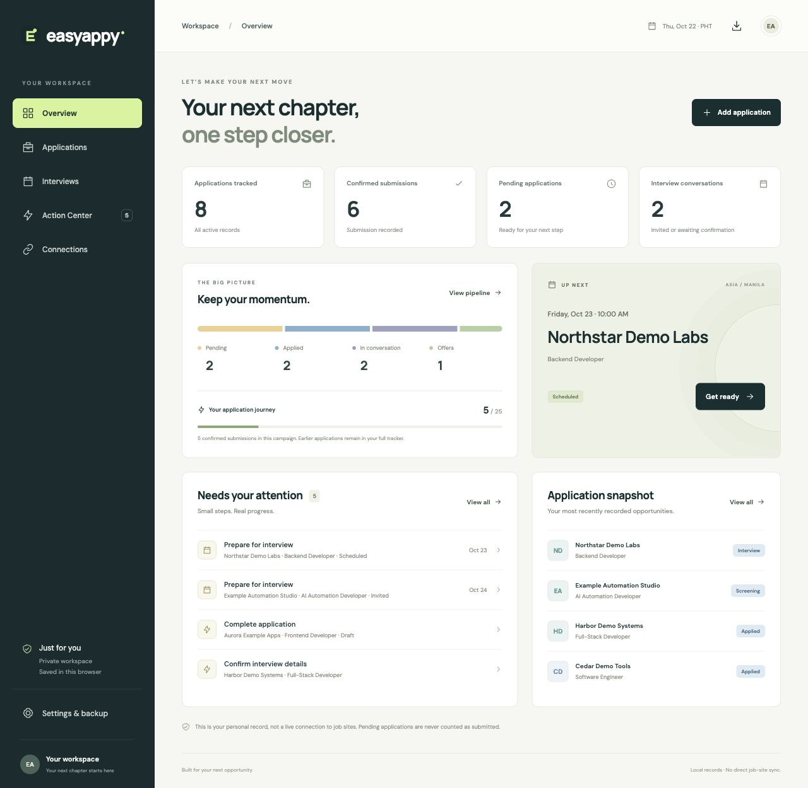
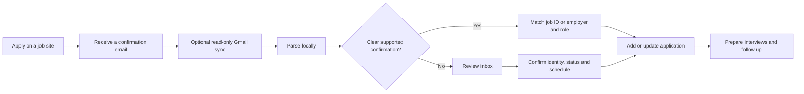
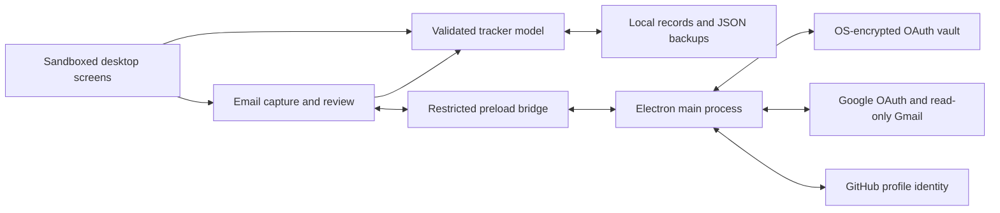

# EasyAppy

A local-first desktop app that turns job-application emails into a clear application pipeline, interview schedule and next-action list.

EasyAppy helps answer: **Where did I apply, what is still pending, and what should I prepare next?** It tracks your search; it does not submit applications or send messages on your behalf.



## Features

- **Overview:** confirmed submissions, pending applications, goal progress and upcoming conversations.
- **Applications:** searchable list and board, editable stages, filters, archive and restore.
- **Interviews:** schedules, recruiter details, preparation notes and follow-ups. Dates display in Philippine time.
- **Action Center:** incomplete applications, due follow-ups, interview preparation and unresolved schedules.
- **Email capture:** optional read-only Gmail OAuth, automatic capture of supported confirmation emails, and a review inbox for uncertain messages.
- **Local backups:** validated JSON export, merge and replacement import, with no account credentials in the export.

The public app starts with an **empty workspace**. To explore the interface, import [docs/demo.json](docs/demo.json) through Settings → Import backup in a disposable profile. Screenshots and fixtures use synthetic data, not a real candidate’s applications or mailbox.

## Run locally

Use Node.js 24+ and npm. The supported desktop packaging target is Apple Silicon macOS.

```sh
npm ci
npm start
```

This builds the source and opens a standalone Electron window. For renderer-only development:

```sh
npm run preview
```

Open `http://127.0.0.1:4318`. The browser preview has separate local storage and cannot use the native OAuth connections.

## Automatic tracking, with review where it matters



Gmail checks matching mail from the **last 30 days**, up to the **newest 500 matching messages per pass**, every five minutes **while the app is open**. You can also sync manually or paste an email without OAuth. The parser runs locally; no AI service receives message content.

Known job identifiers and unambiguous employer/role matches reduce duplicate records. Distinct known job IDs remain separate. Interview invitations, rejections, offers and uncertain messages require review. A missing receipt or an unfamiliar email template may require manual entry; duplicate detection cannot resolve every ambiguous application automatically.

## Desktop architecture



```text
src/main/          Native lifecycle, guarded IPC, OAuth and Gmail API calls
src/preload/       Narrow renderer-to-native bridge
src/renderer/      Screens, model, local persistence and email parsing
assets/icons/      Desktop icon assets
scripts/           Build, packaging and repository checks
tests/             Model, storage, capture, OAuth and packaging tests
docs/              Product flows, architecture, setup and release guidance
```

Read the [product flow](docs/product-flow.md), [architecture](docs/architecture.md), [decisions](docs/architecture-decisions.md) and [desktop/OAuth setup](docs/desktop-setup.md). Editable [Mermaid diagrams](docs/diagrams) accompany the architecture.

## Verify and package

```sh
npm run verify
npm audit --omit=dev
npm run package:mac
```

Verification checks syntax, repository structure, documentation links, behavior tests and the generated runtime. CI runs verification and the production dependency audit. Packaging on macOS creates `release/EasyAppy-darwin-arm64/EasyAppy.app` and checks its local ad-hoc signature. Developer ID signing and notarization are not configured. `dist/` and `release/` are generated and excluded from source control.

## Privacy and current limits

Tracker records and the review inbox are local **and are not encrypted by the app**. OAuth configuration and tokens are stored separately using Electron `safeStorage` with OS encryption. Backups contain tracker records and settings; they exclude credentials, the review inbox and sync checkpoints. Protect your device and exported files accordingly.

Bring your own Google Desktop OAuth client or GitHub OAuth App. No shared production client, account tokens or job-site credentials are bundled. Gmail uses `gmail.readonly`; GitHub uses `read:user` for profile identity only. GitHub’s live authorization flow has not been verified for this release.

There are no direct LinkedIn, Indeed or Jobstreet application-history APIs in this version, no automatic application submission, live Calendar sync, cloud sync or background system service. A Gmail connection is not a job-site account connection.

See [security and privacy](SECURITY.md), [verification scope](docs/verification.md) and the [open-source release notes](docs/open-source-release.md).

## Contributing and license

Contributions are welcome. Start with [CONTRIBUTING.md](CONTRIBUTING.md), use synthetic fixtures, and keep personal records and credentials outside the repository. Released under the [MIT License](LICENSE).
