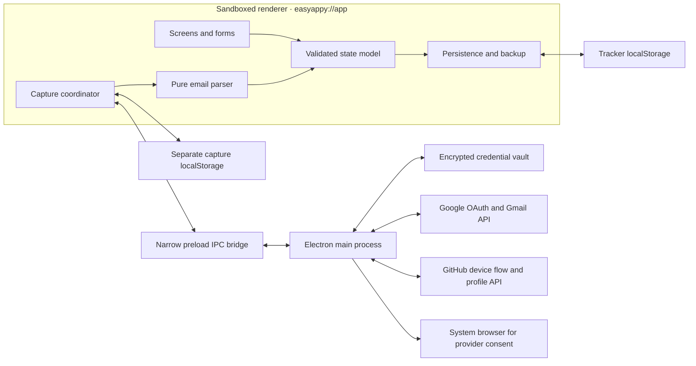
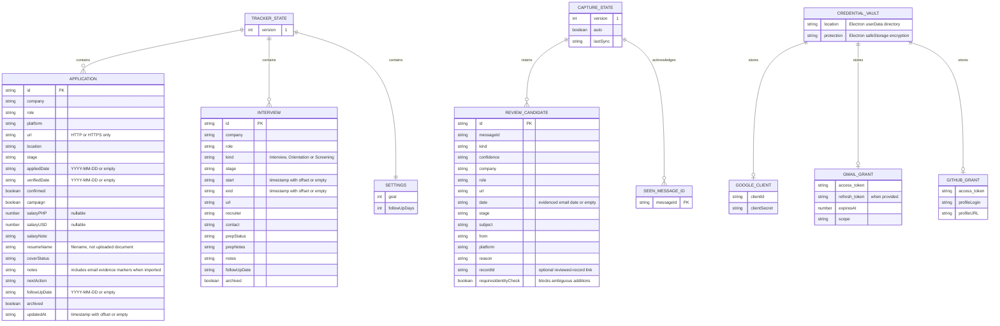
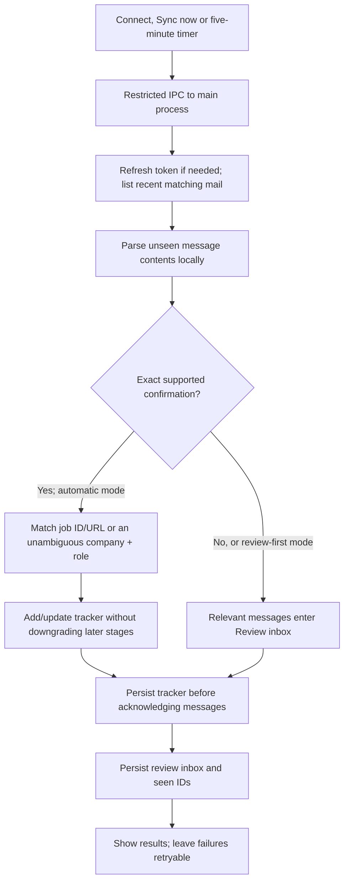

# EasyAppy architecture

EasyAppy is a personal application and interview tracker with an Electron desktop shell, a local web interface and optional read-only email capture. The renderer owns tracker workflows; the main process owns provider authorization, network calls involving account tokens, encrypted credential storage and native file selection.

The public seed is an empty workspace. Optional fictional showcase records live in `docs/demo.json`; they are imported explicitly and are not a real candidate’s history. The app does not have a shared backend or cross-device cloud synchronization.

## Source and build boundaries

```text
src/
  main/
    index.cjs               Electron lifecycle, protocol, IPC and provider operations
    oauth.cjs               Google PKCE, loopback callback and token exchange helpers
    gmail.cjs               Paced reads and bounded quota retries
  preload/
    index.cjs               Explicit easyappyNative IPC bridge
  renderer/
    index.html              Renderer entry document
    app.js                  Events and application workflow coordination
    views.js                Escaped views and editable forms
    model.js                Schema validation, transitions, metrics and actions
    storage.js              Local persistence and validated JSON backup/import
    connections.js          OAuth setup, email paste and connection/review interface
    capture-runtime.js      Email sync, capture checkpoints and review actions
    email-import.js         Pure message classification and application deduplication
    seed.json               Empty initial tracker document
assets/icons/               App icon assets and icon-generation source
scripts/build.mjs           Copies source into generated dist/
tests/                      Node built-in model, storage, capture and OAuth tests
docs/desktop-setup.md        User-owned OAuth setup and desktop instructions
```

The generated application layout is `dist/main`, `dist/preload` and `dist/renderer`. The Electron entry point is `dist/main/index.cjs`; its preload and static renderer paths are relative to that layout. Generated output and release bundles are build artifacts, not the source of truth. Tests import source modules so a stale build cannot make source tests pass accidentally.

## Components and trust boundaries



[Full component diagram](diagrams/components.mmd).

- The renderer runs with context isolation, sandboxing, web security and no Node integration. It loads packaged files through the `easyappy://app/` protocol.
- The preload exposes named operations rather than unrestricted `ipcRenderer`, filesystem access or arbitrary HTTP requests.
- Main-process handlers check the sending web contents, main frame and application origin. The static protocol handler permits only the packaged file-name pattern.
- Provider tokens remain in the main process and encrypted vault. The renderer receives connection status, profile metadata and requested email contents. User-entered OAuth client configuration passes through the setup form to the main process and is saved encrypted.
- External navigation opens validated HTTP/HTTPS links in the system browser. Rendered records and message fields are escaped text; email HTML is parsed as input, not executed.
- A Content Security Policy restricts renderer scripts and connections. Optional Google Fonts are loaded by the stylesheet; this is not an entirely network-free interface.

## Tracker state and local persistence

The version-1 tracker document contains `applications`, `interviews` and `settings`, stored under `easyappy.v1`. Application and conversation IDs are stable, unique across the tracker document and preserved during edits/imports. Applications and interviews are separate records; there is no persisted foreign-key relationship between them.

The empty seed is loaded only for a fresh workspace or as a recovery fallback. It does not overwrite valid saved edits. Demonstration records are kept outside the runtime seed and may be imported into a disposable profile. Dashboard counts are derived from the user’s current records.

Counts are derived from active records:

| Measure                 | Rule                                                                 |
| ----------------------- | -------------------------------------------------------------------- |
| Tracked applications    | Non-archived application records                                     |
| Confirmed submissions   | Non-archived applications with explicit confirmation                 |
| Pending applications    | Active unconfirmed applications outside Rejected/Withdrawn           |
| Campaign progress       | Active applications with both confirmation and campaign membership   |
| Interview conversations | Active Interview records in Invited, Scheduled or Needs confirmation |
| Offers                  | Active applications with stage Offer                                 |
| Archived                | Archived application and conversation records                        |

A draft or blocked stage forces submission confirmation off. A status label alone does not establish that a new submission happened. A dated confirmation email establishes a verification date; an unknown original application date stays empty. Dates shown to the user use `Asia/Manila`; timestamped interviews preserve explicit offsets and cross-midnight end dates.

Storage validates the schema and uses an expected serialized value to reject writes from a stale tab/window. Corrupt saved data is preserved for recovery. Quota or storage failures are reported; in-memory edits are not presented as durable saves. JSON imports are validated before an explicit merge or replacement choice. Matching IDs are replaced by incoming records during a user-approved merge.

Tracker backups include tracker records/settings only. They do not include provider credentials, raw email attachments, the unreviewed capture inbox or its synchronization checkpoints. Local tracker and capture storage are not encrypted by the app; encryption applies to the credential vault.

[Logical document/entity diagram](diagrams/data-model.mmd).



This is a description of local documents, not a relational database schema.

## Gmail capture pipeline



[Detailed synchronization and recovery flow](diagrams/gmail-sync.mmd).

The main process queries the last 30 days of messages matching application/applied/interview/assessment/offer subjects, excluding sent mail, spam and trash. One pass scans at most the newest 500 matching messages. This is a bounded scan, not an exhaustive mailbox archive. Sync runs after connection, on request and every five minutes while the renderer window remains open; it stops with the window and is not an installed background service.

Reads are paced with an 800 ms wait before each request; quota failures use bounded exponential backoff with jitter. A large initial scan can take several minutes. These client-side controls do not guarantee that provider quota limits will never be reached.

The pure parser accepts Gmail multipart messages or normalized email objects. It recognizes exact supported LinkedIn, Indeed and Jobstreet confirmations using message content, sender-domain patterns and extracted company/role details. “High confidence” is a deterministic template classification, not independent sender-identity or SPF/DKIM verification.

- Job alerts, recommendations and outgoing messages do not confirm applications.
- Clear supported confirmations can be added automatically. New imports are outside the campaign goal until the user includes them.
- Invitations, rejections, offers and incomplete or ambiguous messages remain for review. An invitation does not imply an accepted RSVP or a verified schedule.
- Canonical job IDs/URLs take priority for deduplication. Normalized employer/role matching is used only when it is unambiguous; distinct known job IDs stay separate.
- An existing Screening, Interview, Offer, Rejected or Withdrawn application is not reset to Applied by a later confirmation receipt.
- Message evidence markers make repeated receipts idempotent. Gmail seen IDs provide a separate fetch checkpoint.

An authorized review can request exact Gmail message IDs through a narrow read-only IPC operation (at most 500 validated IDs). It fetches full MIME alternatives and calendar attachments up to 1 MB; other attachments are not fetched by that operation. A reviewed clarification can link to an existing application or interview, so opening it edits that record instead of creating a duplicate. Identity-ambiguous candidates cannot open an add form until their identifying details are resolved. Interviews with conflicting or incomplete schedules appear as confirmation actions without a guessed time.

Capture state uses `easyappy.capture.v1`: seen message IDs, pending review candidates, automatic-mode preference and last-sync time. The tracker must save successfully before the capture checkpoint advances, including a retry whose marker is already present in unsaved memory. If saving the checkpoint fails, previous capture state is restored so the message can be retried without duplicating the application.

An internal experimental handler supports native `.eml` file import, but it is not exposed as a delivered UI feature because its file-picker flow did not pass native QA. Pasted email is parsed locally and retained for review. Neither path sends email text to an AI service. No application can be discovered from email if no receipt arrives, if it falls outside the scan window/limit, or if its template cannot be recognized.

## Provider authorization

### Google

Google uses the installed/desktop application authorization-code flow with random state, PKCE S256 and a temporary loopback listener bound to `127.0.0.1` on an ephemeral port. The main process checks callback state/path/result and the granted `gmail.readonly` scope before reporting success. It stores token expiry and uses the refresh token, when supplied, before access tokens expire.

[Google OAuth sequence](diagrams/oauth-google.mmd).

```mermaid
sequenceDiagram
  actor User
  participant UI as Renderer
  participant Bridge as Preload bridge
  participant Main as Main + oauth.cjs
  participant Vault as Encrypted local vault
  participant Browser as System browser
  participant Google as Google OAuth
  participant Gmail as Gmail API

  Note over User,Gmail: Implemented flow; live account authorization requires user-owned registered credentials and consent
  User->>UI: Enter Desktop client ID and secret
  UI->>Bridge: configureGoogle(credentials)
  Bridge->>Main: Restricted IPC
  Main->>Main: Validate Desktop client configuration
  Main->>Vault: Encrypt and save client configuration
  Main-->>UI: Configuration status only
  User->>UI: Connect Gmail
  UI->>Bridge: connectGoogle()
  Bridge->>Main: Restricted IPC
  Main->>Main: Generate random state and PKCE verifier/challenge
  Main->>Main: Bind temporary 127.0.0.1 listener on random port
  Main->>Browser: Open Google authorization URL
  Browser->>Google: Request gmail.readonly with S256 PKCE
  User->>Google: Sign in and grant read-only consent
  Google-->>Browser: Redirect with code and state
  Browser->>Main: GET loopback /oauth/callback
  Main->>Main: Verify state, path and authorization result
  Main->>Google: Exchange code + verifier + redirect URI
  Google-->>Main: Access token, expiry and refresh token when supplied
  Main->>Main: Require granted gmail.readonly scope
  Main->>Vault: Encrypt token state and expiry
  Main->>Gmail: Read account profile using bearer token
  Gmail-->>Main: Account email
  Main-->>UI: Connected status and account email, no tokens
  Note over Main,Vault: Before API calls near expiry, main refreshes access tokens and saves updated encrypted state
  Note over Main,Browser: Consent denial, invalid state, exchange failure or timeout does not create a successful connection
```

No registered shared Google client or account token is bundled. A live connection requires the user’s Desktop OAuth project configuration, enabled Gmail API and provider consent. Test-mode provider grants may expire and require reconnection. See [desktop setup](desktop-setup.md) for account setup and consent steps.

### GitHub

GitHub uses a user-registered OAuth App with Device Flow enabled and the `read:user` scope. Main keeps the device code, enforces polling intervals/expiry, obtains the profile after authorization and stores the account token encrypted. The renderer sees the user code and connection/profile status, not the access token.

[GitHub device-flow sequence](diagrams/oauth-github.mmd).

```mermaid
sequenceDiagram
  actor User
  participant UI as Renderer
  participant Main as Main through preload IPC
  participant Browser as System browser
  participant GitHub
  participant Vault as Encrypted local vault

  Note over User,Vault: Requires a user-registered GitHub OAuth App with Device Flow enabled
  User->>UI: Enter OAuth App client ID and Connect
  UI->>Main: startGitHub(clientId)
  Main->>GitHub: Request device code with read:user scope
  GitHub-->>Main: Device code, user code, interval and expiry
  Main->>Browser: Open github.com/login/device
  Main-->>UI: User code, polling interval and expiry
  User->>GitHub: Enter displayed code and authorize
  User->>UI: Check authorization
  UI->>Main: pollGitHub()
  Main->>Main: Enforce polling interval and expiry
  Main->>GitHub: Exchange device code
  alt Still pending or slow down
    GitHub-->>Main: Pending or increased interval
    Main-->>UI: Waiting status
  else Authorized
    GitHub-->>Main: Access token
    Main->>GitHub: Read authenticated profile
    GitHub-->>Main: Login and profile URL
    Main->>Vault: Encrypt token and profile state
    Main-->>UI: Connected profile status, no token
  end
  Note over UI,GitHub: Profile identity only; GitHub does not provide job-application history
```

This connection establishes developer profile identity. It does not retrieve job-application history. LinkedIn, Indeed and Jobstreet are represented through email receipts and ordinary job links; there are no direct applicant-history API integrations and no collection of job-site passwords or session cookies.

## Verification and operational limits

Node’s built-in test runner covers validation, counts, immutable transitions, unknown dates, cross-midnight meetings, archive/restore, safe URLs, backup recovery, stale writes, email classification/deduplication, capture retry ordering and OAuth helper boundaries. These tests do not establish that a user’s live Google or GitHub account has been authorized.

The desktop build targets Apple Silicon macOS. Packaging/signing instructions and the current distribution limitations belong in [desktop setup](desktop-setup.md). Browser preview and desktop app have separate local storage; a tracker JSON backup is the explicit transfer mechanism. There is no automatic cloud backup, shared-account workspace, live Calendar synchronization or automatic job submission in this version.
