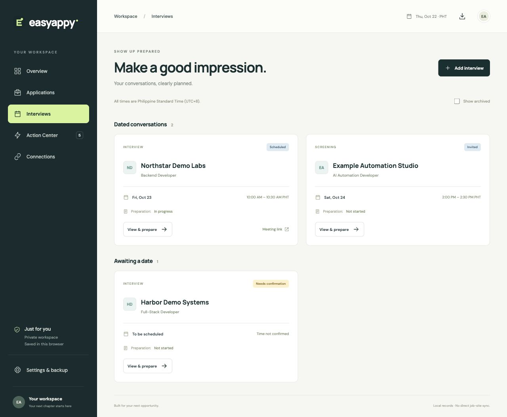
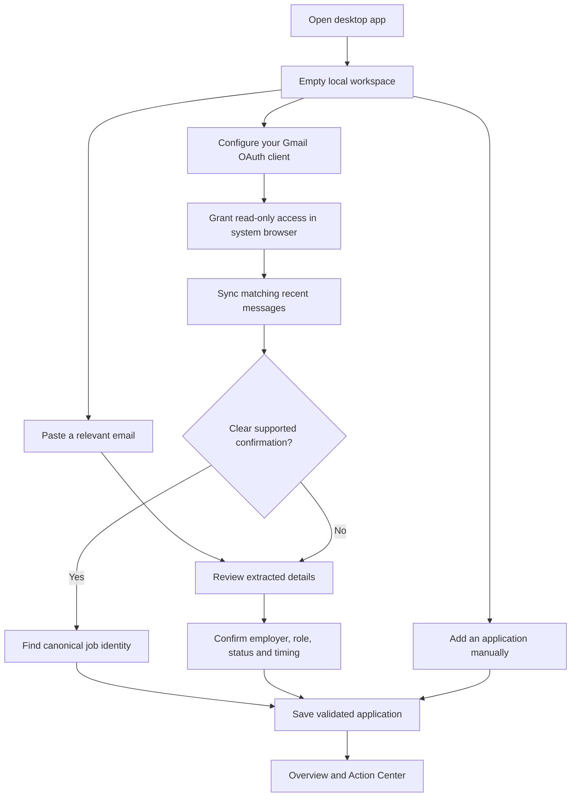
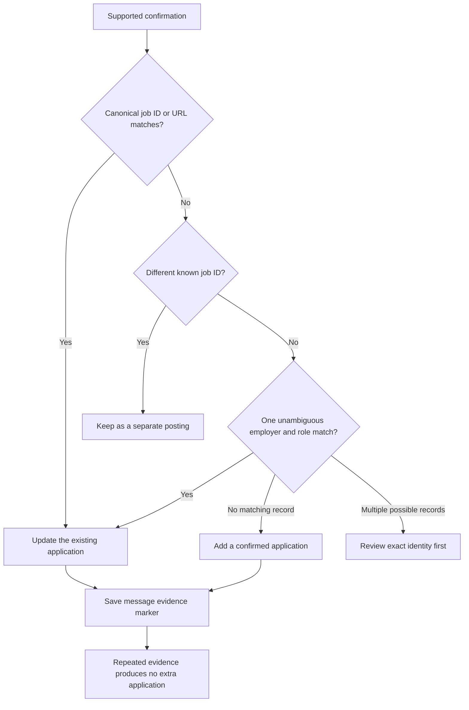

# Product flow

EasyAppy keeps application progress, interviews and next steps together on one device. It records what happened after an application; it does not apply to jobs, send recruiter messages or change a calendar for you.

## First use

A fresh workspace contains no personal history. An optional [fictional demo backup](demo.json) is available for evaluation in an isolated profile. It is separate from the empty runtime seed.

## Application progress

An application stores employer, role, source, job URL, stage, known dates, résumé filename, cover-letter status, notes and next action. The tracker stores the résumé’s name; it does not upload the document to an employer.

A pending draft, sign-in, verification or information step is not a confirmed submission. Confirmation is separate from stage, and active confirmed records determine submission totals. Goal membership is explicit so imported historical receipts do not automatically inflate a current search target.

Search and filters narrow the list or board. Edits preserve the stable record ID. Archive hides a record from active totals without deleting its contents; restore brings it back. Dates unsupported by evidence remain blank.

## Avoiding duplicate records

The parser recognizes supported templates; it does not prove sender authenticity or make every employer alias equivalent. Similar job titles alone are insufficient to merge different known postings. A reviewed item linked to an existing record reopens that record. Items requiring identity confirmation cannot open a new-record form until their identifying details are resolved.

## Interviews and preparation

Interview, screening and orientation conversations are separate records. Store both start and end with explicit offsets, or leave both blank. The interface displays Philippine time and preserves cross-midnight meetings. A conflicting timezone or missing duration should become **Needs confirmation**, with the discrepancy in notes.

An invitation, scheduled conversation, attendance and completion are different facts. Do not mark attendance just because its date is in the past. Preparation status and notes help organize talking points; Action Center surfaces preparation and confirmation work. There is no live Calendar synchronization or RSVP automation.

## Safe persistence and backup

Edits pass through schema validation before saving. Stale writes are rejected, and corrupt saved data is preserved for recovery. The capture pipeline saves the tracker before acknowledging messages; a failed save remains retryable rather than silently losing evidence.

Export a tracker JSON backup from Settings. Import validates the file before you choose merge or replacement. Merge replaces matching record IDs with incoming records; it is not a mailbox-wide fuzzy deduplication operation. Backups omit OAuth credentials, review inbox and synchronization checkpoints. Read [security and privacy](../SECURITY.md) before sharing files.

## Current boundaries

Email sync runs while the desktop app is open, within a 30-day/newest-500 matching-message window. It cannot reconstruct applications that produced no identifiable receipt. There is no job submission engine, direct job-site history connection, background system service or shared cloud workspace. See [setup](desktop-setup.md) and [verification](verification.md).
